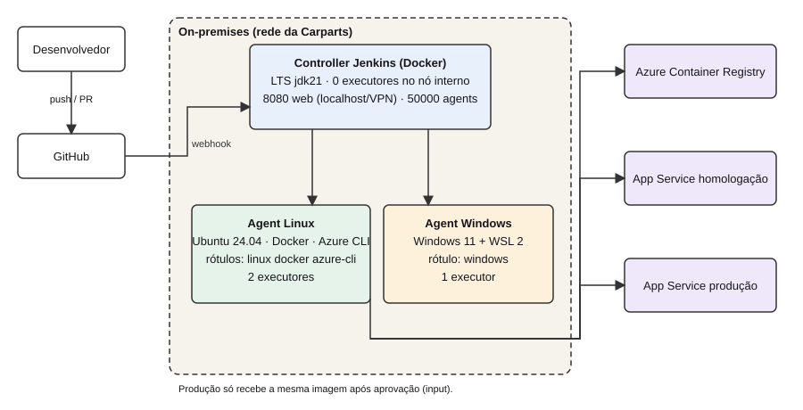
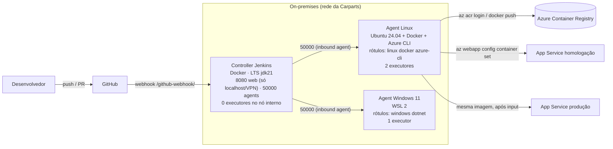

# E1 · Arquitetura Jenkins da Carparts

Versão Mermaid

| Componente | SO | Executores | Rótulos | Porta |
|---|---|---|---|---|
| Controller | contêiner Docker | **0** | — | 8080 (web), 50000 (agents) |
| Agent Linux | Ubuntu 24.04 | 2 | `linux`, `docker`, `azure-cli` | saída para 50000 |
| Agent Windows | Windows 11 + WSL 2 | 1 | `windows` | saída para 50000 |

## Cenário escolhido: controller em Docker local

| Cenário | Custo mensal (estim.) | Riscos |
|---|---|---|
| **Docker local (escolhido)** | ~US$ 0 de nuvem; só energia/hardware já existente | Disponibilidade depende da máquina; backup do volume `jenkins_home` é responsabilidade da equipe |
| VM Azure | ~US$ 70–140 (B2ms/D2s + disco + IP) consome quase todo o orçamento de US$ 150 | Porta 8080 exposta à internet; ERP on-premises precisa de VPN |
| AKS | ≥ US$ 150 (nós + controle) | Excede orçamento e complexidade para equipe de 5 pessoas |

**Justificativa:** os dados do ERP ficam on-premises, a equipe é pequena e o orçamento de nuvem (US$ 150) deve ser reservado para homologação (ACR + App Service). A porta 8080 é publicada só em `127.0.0.1`; acesso remoto por túnel SSH/VPN, nunca aberta para qualquer origem.

> Evidência a anexar: print do diagrama e do painel *Manage Jenkins → Nodes* com os agents conectados.
